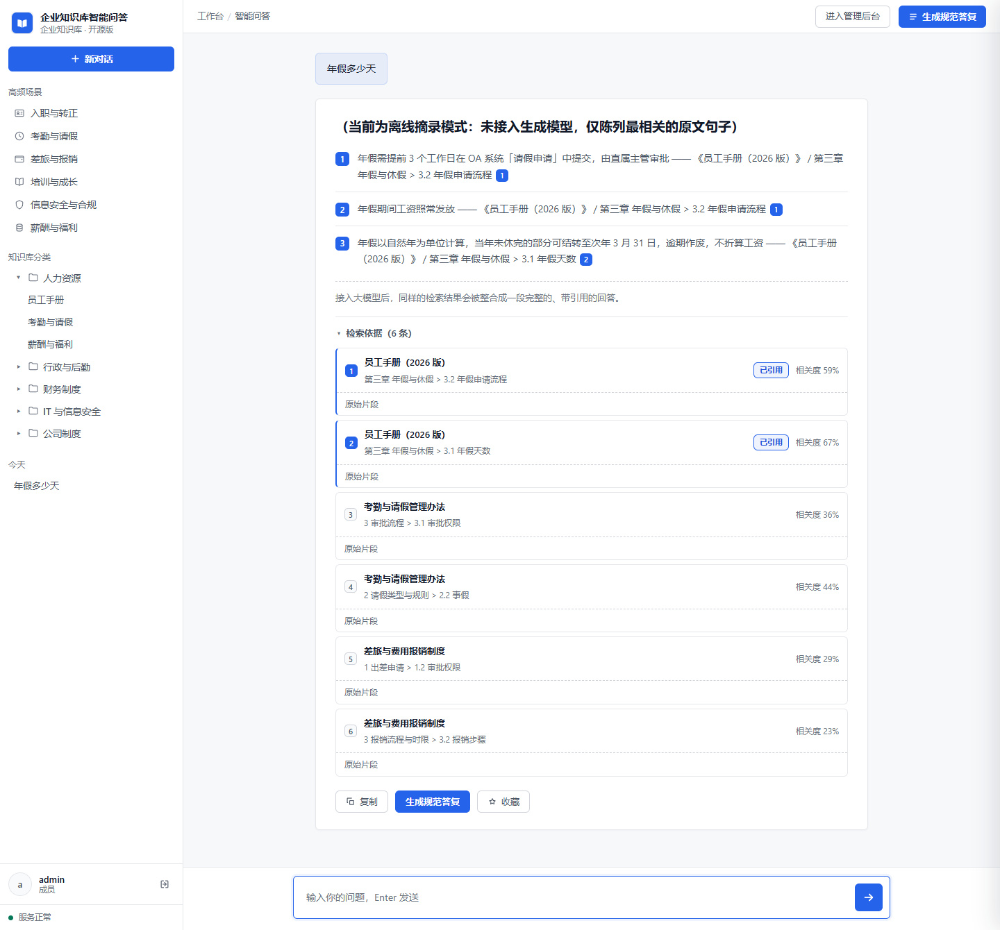
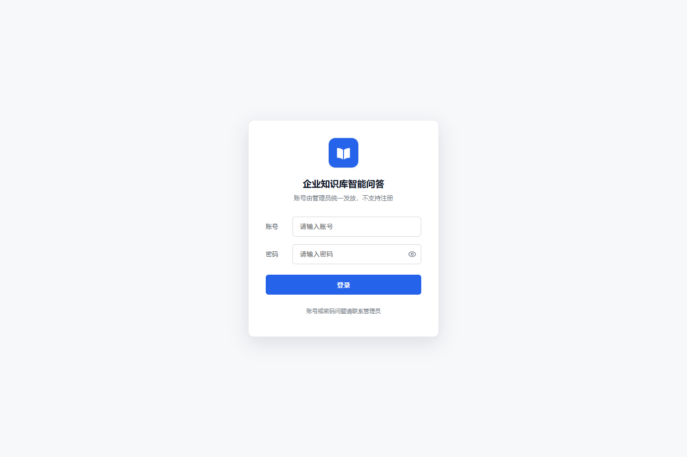
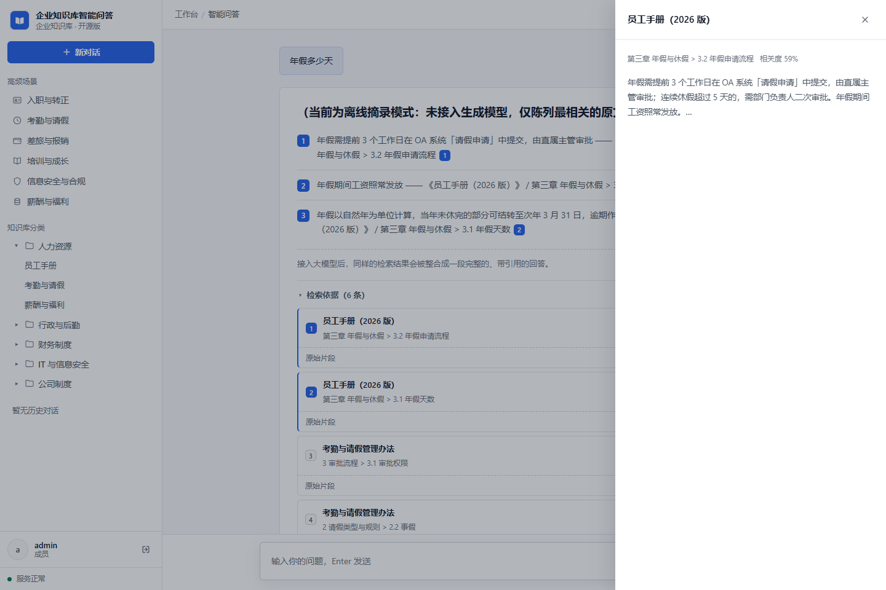
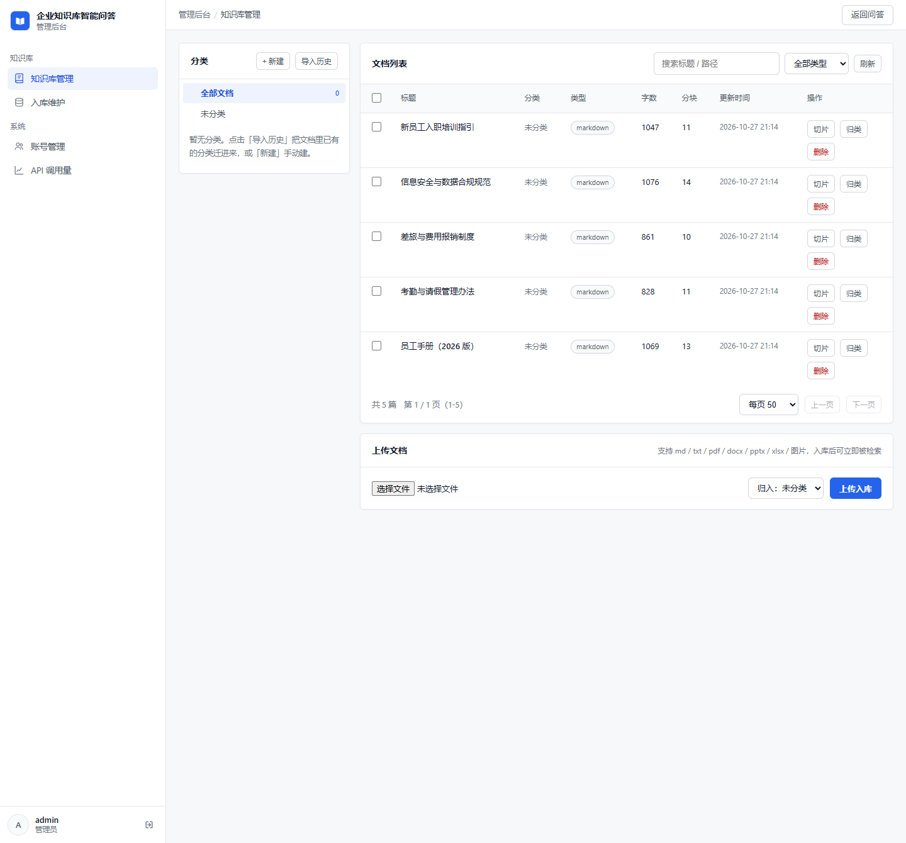

# rag-knowledge-base

把公司的制度文档（员工手册、考勤、报销、信息安全规范……）放进去，员工用**自己的话**提问，系统从文档里找出依据、**带着出处**回答；文档里没写的，它说"不知道"，不编。

**所有解析和向量化都在你自己的机器上完成**，原文不出内网——只有检索命中的少数片段会发给云端大模型（也可以完全不用云端，见[常见问题](#常见问题)）。

具体来说它能做四件事：

- **问一句，答一段，每个结论都标出处**——点编号能直接看原文那一段，不用自己翻文档；
- **文档里没写的，它说"不知道"**——不硬凑一个看起来像答案的东西；
- **认得的格式多**：PDF、Word、PPT、Excel、Markdown、网页、以及扫描件（走 OCR）；
- **多人用**：账号由管理员发放，各人看各人的对话记录。



---

## 三步跑起来

前提：装好 **Python 3.10+** 和 **Git**。磁盘留 3GB（首次会自动下载约 640MB 的模型，之后就离线了）。

### 第 1 步：下载并装依赖

```bash
git clone https://github.com/lhaozan-droid/rag-knowledge-base.git
cd rag-knowledge-base

python -m venv .venv
.venv\Scripts\activate            # Windows
source .venv/bin/activate         # macOS / Linux

pip install -r requirements.txt
```

> `pip install` 会比较慢，`chromadb`、`fastembed`、`opencv`、`pymupdf` 都是大包，属正常。

### 第 2 步：把示例文档入库

```bash
python -m app.cli ingest ./demo-docs
```

等它跑完，看到这样就算成功：

```
新增 5 / 更新 0 / 跳过 0 / 失败 0
本次写入 59 个 chunk；库内共 5 篇文档、59 个 chunk；耗时 6.36s
```

### 第 3 步：启动

```bash
python -m app.cli serve --host 127.0.0.1 --port 8080
```

浏览器打开 **http://127.0.0.1:8080**。

> **不想敲命令？** `scripts/` 下有现成脚本：Windows 双击 `scripts\ingest_demo.bat` 和 `scripts\run_server.bat` 就行；macOS/Linux 用同名的 `.sh`。依赖装在别的 Python 环境里时，用 `RAG_PYTHON=/path/to/python` 指定解释器。

---

## 第一次登录：密码在哪？

**这是最容易卡住的一步，单独讲清楚。** 系统没有默认密码，也没法注册。



1. 打开 http://127.0.0.1:8080 ，看到上面的登录页。
2. 用户名填 `admin`，密码**随便填一个**，点「登录」。
3. 页面提示「账号或密码错误」——**这是正常的，不是出错**。这一步只是把账号"叫醒"。
4. **回到刚才启动服务的那个终端窗口**，会多出一行：

   ```
   [auth] 初始化管理员账号 admin，初始密码：DUiVrwVxoHi5（请登录后立即修改）
   ```

5. 用 `admin` + 这串随机密码**重新登录**，就进去了。
6. 进去后第一件事：点右上角改密码。

> **这串密码只打印这一次。** 关掉终端就找不回来了。真丢了：删掉 `data/auth.json`，重启服务，会重新生成一个（代价是已建的账号全部丢失）。

**为什么这么设计**：不预置默认密码，就不会出现"部署完忘了改、被人用 admin/123456 直接进"的事故。密码只在第一次有人登录时随机生成，且只打印在你自己的终端里。

---

## 进来之后看到什么

左边一栏是「新对话」「高频场景」「知识库分类」和按时间分组的历史会话，中间是问答区。点分类名字就是把那个词当问题发出去。

答案卡片从上到下：结论句 → 分条规则 → 补充说明 → **检索依据** → 复制 / 生成规范答复 / 收藏。



### 「检索依据」怎么读

每条回答末尾有个**默认收起**的「检索依据（6 条）」折叠块，点开能看到这次一共召回了哪些片段，每条显示：文档名、章节路径、有没有被正文引用（「已引用」）、相关度百分比。

三个常用动作：

- **点某一行** → 右边滑出这一条的原文（上图那个抽屉）。
- **点正文里的 `[1]`** → 自动展开列表、滚到第 1 条、高亮一下，并展开它的原始片段。
- **列表里没标「已引用」的** → 说明召回了但答案没用到。想补文档、或怀疑分块切得不好时，看的就是这些。

> 列了 6 条、正文只标了 `[1] [2]` 是**正常的**：正文只用真正用得上的几条，列表是全部召回结果。
>
> 「相关度 59%」是**语义相似度**（0~100%），不是排序依据。列表按检索综合排名，所以会出现第 1 条 59%、第 2 条 67% 的"倒挂"，不是算错了。

---

## 管理后台

管理员账号登录后，问答页右上角会多一个「进入管理后台」。



四块功能：

- **知识库管理** —— 看所有文档（标题、分类、类型、字数、分块数、更新时间），上传新文档、看切片、归类、删除；
- **入库维护** —— 重新入库、重建索引；
- **账号管理** —— 给同事建号、停用、改角色、重置密码；
- **API 调用量** —— 各接口被调用了多少次。

> 同事要用这个系统，就在这里给他们建账号。系统不开放自助注册。

---

## 换成你自己的文档

1. **改一个配置**：打开 `config.yaml`，把 `ingest.root` 从 `./demo-docs` 改成你自己的文档目录（也可以不动配置，直接用命令指定）。
2. **入库**：

   ```bash
   python -m app.cli ingest ./你的文档目录
   ```

3. **清掉示例文档**（可选）：后台「知识库管理」里删掉那 5 篇示例，或者

   ```bash
   python -m app.cli ingest ./你的文档目录 --reset
   ```

支持的格式：`.md` `.txt` `.csv` `.pdf` `.docx` `.pptx` `.xlsx` `.html`，以及图片（扫描件走 OCR）。子目录会递归扫描。

改完文档要**重新入库**，只改文件不跑 `ingest` 是不会生效的。

---

## 常见问题

**Q：没有 API Key 能用吗？**

能。不配 Key 时自动进入「离线摘录模式」：不做总结，只把命中的原文句子挑几句列出来并标出处。用来验证入库和检索够用，但它**不会判断"文档里到底有没有答案"**，问库里没有的东西它会照样陈列几段看似相关的原文。

想让它正经回答，在项目根目录建一个 `.env` 文件（可以 `cp .env.example .env` 复制模板），填入：

```
LLM_API_KEY=你的key
```

任何 OpenAI 兼容的服务都能用（DeepSeek、通义、混元、vLLM、Ollama 的 OpenAI 模式）。

**Q：第一次 `ingest` 卡住不动？**

在下载模型（约 640MB），看网络。代码默认走 `hf-mirror.com` 镜像，下载完就完全离线了。

**Q：`data/models/` 占的空间比模型大一倍？**

Windows 上禁用了符号链接，同一份模型会在 `blobs/` 和 `snapshots/` 各存一份。换 Linux/macOS 不会。

**Q：局域网里别的电脑访问不到？**

默认只监听 `127.0.0.1`，本机之外连不上。要给别人用，改成 `--host 0.0.0.0`，但**别把端口直接丢到公网**，请放在 Nginx 之类的反向代理后面。

**Q：改了分类名，按分类搜不到东西？**

索引里还存着旧分类名。去后台「入库维护」跑一次「重建 BM25」即可。

**Q：日志里出现「降级为 hash 向量」怎么办？**

说明 embedding 模型没加载成功（多半是内存不够）。此时分数接近 0、排序随机，但**接口不报错**，你会以为"这东西不好用"。先解决模型加载（加内存 / 关掉别的程序重跑），别去调检索参数。

**Q：重启服务后，之前的对话还在吗？**

在。会话、文档、账号都存在 `data/` 目录里。

---

## 想深入看

| 你想了解 | 去哪看 |
|---|---|
| 内部怎么实现的、为什么这么设计 | [docs/architecture.md](docs/architecture.md) |
| 全部配置项，以及改了有什么代价 | [docs/config.md](docs/config.md) |
| 不用网页，用命令行或接进自己的系统 | [docs/api.md](docs/api.md) |
| 改代码、跑测试、目录结构 | [docs/development.md](docs/development.md) |

## 技术栈

Python 3.10+ · FastAPI · Chroma · BM25 · FastEmbed（本地 ONNX）+ 任意 OpenAI 兼容大模型

## License

[MIT](LICENSE)
